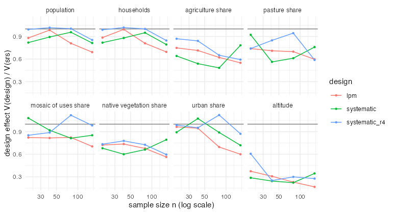
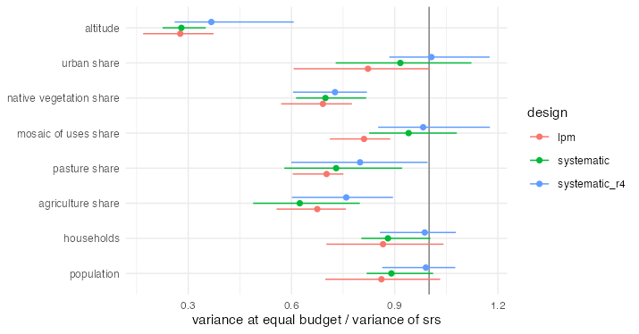

# E1b — spatial balance with real study variables

Generated by `experiments/analysis/e1b_summary.R` from `experiments/out/e1b` (end 2026-10-10 17:07:29 elapsed 28.4 min).

## Data

Frame F4: the 7868 cells of 1 km² of the IBGE 2022 statistical grid (grade estatística, `BR1KM_20251002`) in the Vale do Ipojuca microregion, Pernambuco agreste (IBGE code 26008), built by
`experiments/data/build_f4_ipojuca.R`. Variables per cell: population and private households (IBGE,
Censo Demográfico 2022); shares of agriculture, pasture, mosaic of uses (MapBiomas class 21, mostly
smallholder crops mixed with pasture), native vegetation and urban area (MapBiomas Collection 10,
2024, 30 m); mean altitude (Copernicus DEM GLO-30). Depot in Caruaru; travel by haversine distance x
1.3 at 60 km/h; costs as in E1 and E2 (1.5 per minute, 60 per visited cell, 200 per daily route).
Designs srs, lpm, systematic (Hilbert) in one and in four replicates; 1000 samples per design and n in {20, 40, 80, 160}.

## Spatial structure of the variables

Moran's I with the 8 nearest cells, and the coefficient of variation across cells:

|y                       | moran_i|   cv|
|:-----------------------|-------:|----:|
|population              |    0.59| 6.25|
|households              |    0.60| 6.35|
|agriculture share       |    0.71| 5.62|
|pasture share           |    0.61| 0.76|
|mosaic of uses share    |    0.50| 1.18|
|native vegetation share |    0.65| 0.59|
|urban share             |    0.64| 3.92|
|altitude                |    0.95| 0.25|

## Gain: design effect at equal n (true variance)

|y                       | moran_i|design        | n = 20| n = 40| n = 80| n = 160|
|:-----------------------|-------:|:-------------|------:|------:|------:|-------:|
|population              |    0.59|lpm           |   0.88|   0.98|   0.81|    0.69|
|population              |    0.59|systematic    |   0.82|   0.89|   0.96|    0.81|
|population              |    0.59|systematic_r4 |   0.99|   1.02|   1.00|    0.85|
|households              |    0.60|lpm           |   0.88|   0.99|   0.81|    0.69|
|households              |    0.60|systematic    |   0.82|   0.88|   0.95|    0.79|
|households              |    0.60|systematic_r4 |   0.99|   1.02|   1.00|    0.85|
|agriculture share       |    0.71|lpm           |   0.75|   0.71|   0.62|    0.55|
|agriculture share       |    0.71|systematic    |   0.64|   0.54|   0.48|    0.78|
|agriculture share       |    0.71|systematic_r4 |   0.87|   0.84|   0.65|    0.59|
|pasture share           |    0.61|lpm           |   0.74|   0.71|   0.70|    0.60|
|pasture share           |    0.61|systematic    |   0.92|   0.56|   0.61|    0.76|
|pasture share           |    0.61|systematic_r4 |   0.74|   0.85|   0.94|    0.59|
|mosaic of uses share    |    0.50|lpm           |   0.82|   0.82|   0.82|    0.70|
|mosaic of uses share    |    0.50|systematic    |   1.08|   0.92|   0.81|    0.85|
|mosaic of uses share    |    0.50|systematic_r4 |   0.85|   0.89|   1.12|    0.98|
|native vegetation share |    0.65|lpm           |   0.72|   0.74|   0.68|    0.56|
|native vegetation share |    0.65|systematic    |   0.68|   0.60|   0.66|    0.79|
|native vegetation share |    0.65|systematic_r4 |   0.73|   0.78|   0.73|    0.60|
|urban share             |    0.64|lpm           |   0.96|   0.95|   0.70|    0.60|
|urban share             |    0.64|systematic    |   0.89|   1.07|   0.89|    0.72|
|urban share             |    0.64|systematic_r4 |   0.99|   0.95|   1.12|    0.87|
|altitude                |    0.95|lpm           |   0.37|   0.31|   0.23|    0.17|
|altitude                |    0.95|systematic    |   0.29|   0.24|   0.22|    0.34|
|altitude                |    0.95|systematic_r4 |   0.61|   0.25|   0.30|    0.28|

## Price: travel of the design over the travel of srs at equal n

|selection  |limit  | n <= 40| 40 < n <= 150| n > 150|
|:----------|:------|-------:|-------------:|-------:|
|lpm        |daily  |    1.10|          1.12|    1.12|
|lpm        |single |    1.09|          1.13|    1.14|
|systematic |daily  |    1.08|          1.12|    1.11|
|systematic |single |    1.07|          1.13|    1.12|

Exponent of n in the travel (BHH predicts 0.5):

|selection  |limit  | exponent|
|:----------|:------|--------:|
|lpm        |daily  |    0.452|
|lpm        |single |    0.447|
|srs        |daily  |    0.449|
|srs        |single |    0.435|
|systematic |daily  |    0.454|
|systematic |single |    0.447|

## Equal budget

Variance of the design over the variance of srs at the same budget (mean, best and worst over route
limits, interview costs and budgets buying 20 to 160 srs units; `wins` is the share of cases below 1):

|y                       |design        | efficiency| best| worst| wins|
|:-----------------------|:-------------|----------:|----:|-----:|----:|
|population              |lpm           |       0.86| 0.70|  1.03| 0.81|
|population              |systematic    |       0.89| 0.82|  1.01| 0.94|
|population              |systematic_r4 |       0.99| 0.86|  1.08| 0.50|
|households              |lpm           |       0.87| 0.70|  1.04| 0.75|
|households              |systematic    |       0.88| 0.80|  1.00| 0.94|
|households              |systematic_r4 |       0.99| 0.86|  1.08| 0.50|
|agriculture share       |lpm           |       0.68| 0.56|  0.76| 1.00|
|agriculture share       |systematic    |       0.62| 0.49|  0.80| 1.00|
|agriculture share       |systematic_r4 |       0.76| 0.60|  0.90| 1.00|
|pasture share           |lpm           |       0.70| 0.60|  0.75| 1.00|
|pasture share           |systematic    |       0.73| 0.58|  0.92| 1.00|
|pasture share           |systematic_r4 |       0.80| 0.60|  1.00| 1.00|
|mosaic of uses share    |lpm           |       0.81| 0.71|  0.89| 1.00|
|mosaic of uses share    |systematic    |       0.94| 0.83|  1.08| 0.75|
|mosaic of uses share    |systematic_r4 |       0.98| 0.85|  1.18| 0.56|
|native vegetation share |lpm           |       0.69| 0.57|  0.78| 1.00|
|native vegetation share |systematic    |       0.70| 0.61|  0.82| 1.00|
|native vegetation share |systematic_r4 |       0.73| 0.60|  0.82| 1.00|
|urban share             |lpm           |       0.82| 0.61|  1.00| 0.94|
|urban share             |systematic    |       0.92| 0.73|  1.12| 0.75|
|urban share             |systematic_r4 |       1.01| 0.88|  1.18| 0.69|
|altitude                |lpm           |       0.28| 0.17|  0.37| 1.00|
|altitude                |systematic    |       0.28| 0.23|  0.35| 1.00|
|altitude                |systematic_r4 |       0.37| 0.26|  0.61| 1.00|

## Variance estimators (as E3)

Relative bias of `design_variance()` and coverage of the t interval, mean over n:

|y                       |design        |method     |rel_bias | coverage|
|:-----------------------|:-------------|:----------|:--------|--------:|
|population              |srs           |srs        |+3%      |    0.631|
|population              |lpm           |local-mean |+14%     |    0.641|
|population              |systematic    |local-mean |+10%     |    0.616|
|population              |systematic_r4 |replicates |-2%      |    0.686|
|households              |srs           |srs        |+3%      |    0.625|
|households              |lpm           |local-mean |+14%     |    0.636|
|households              |systematic    |local-mean |+11%     |    0.608|
|households              |systematic_r4 |replicates |-2%      |    0.683|
|agriculture share       |srs           |srs        |+1%      |    0.719|
|agriculture share       |lpm           |local-mean |+20%     |    0.744|
|agriculture share       |systematic    |local-mean |+45%     |    0.750|
|agriculture share       |systematic_r4 |replicates |-1%      |    0.773|
|pasture share           |srs           |srs        |-6%      |    0.943|
|pasture share           |lpm           |local-mean |+12%     |    0.959|
|pasture share           |systematic    |local-mean |+12%     |    0.963|
|pasture share           |systematic_r4 |replicates |+1%      |    0.941|
|mosaic of uses share    |srs           |srs        |+1%      |    0.924|
|mosaic of uses share    |lpm           |local-mean |+12%     |    0.940|
|mosaic of uses share    |systematic    |local-mean |-4%      |    0.915|
|mosaic of uses share    |systematic_r4 |replicates |-2%      |    0.945|
|native vegetation share |srs           |srs        |-1%      |    0.950|
|native vegetation share |lpm           |local-mean |+12%     |    0.954|
|native vegetation share |systematic    |local-mean |+13%     |    0.960|
|native vegetation share |systematic_r4 |replicates |+1%      |    0.946|
|urban share             |srs           |srs        |+2%      |    0.804|
|urban share             |lpm           |local-mean |+24%     |    0.824|
|urban share             |systematic    |local-mean |+7%      |    0.800|
|urban share             |systematic_r4 |replicates |-0%      |    0.865|
|altitude                |srs           |srs        |+5%      |    0.958|
|altitude                |lpm           |local-mean |+39%     |    0.972|
|altitude                |systematic    |local-mean |+46%     |    0.966|
|altitude                |systematic_r4 |replicates |-1%      |    0.946|

## What this means

1. **The price of balance on a real 1 km grid is 7 to 14% more travel** at equal n, slightly more than
   on the synthetic frames of E1 because the frame is larger (the advantage of srs samples, which clump
   by chance, persists to larger n). The travel exponent is 0.44 to 0.45, close to BHH.
2. **Every real variable is spatially autocorrelated** (Moran's I 0.50 to 0.95 with 8 neighbours), and
   balance wins at equal budget for all of them with lpm: the variance falls by 13 to 14% for population
   and households, 18 to 32% for the land-use shares and 72% for altitude. This is the region of E1
   between the `short` and `long` ranges, as the Moran's I suggests.
3. **lpm is the safest design**: it never loses by more than 4% (population, households at the
   smallest budget) and wins in most cases. Systematic sampling in one replicate is close to lpm for
   the land-use shares; with four replicates it gives up part of the gain (the replicates are
   coarser samples) in exchange for an unbiased variance estimate.
4. **Estimators**: as in E3, srs and replicates are unbiased and the local-mean estimator is
   conservative (+7 to +46%). The low coverage for population, households, agriculture and urban
   share (0.61 to 0.86 for *every* design, srs included) is not a variance problem: these variables
   are extremely skewed (coefficient of variation 4 to 6 across cells; most cells are empty and a
   few hold towns), so the HT total is far from normal at n <= 160. Such variables need stratification
   by size (urban cells apart) or probability proportional to a size measure, not a better variance
   estimator; the shares of pasture, mosaic and native vegetation and altitude cover 0.92 to 0.97.
5. For the paper: E1's conclusion holds on real data. With a routed price of about 10% in travel, a
   spatially balanced design is worth it for every variable an agricultural or household area-frame
   survey measures here; the size of the gain tracks the spatial autocorrelation of the variable.
