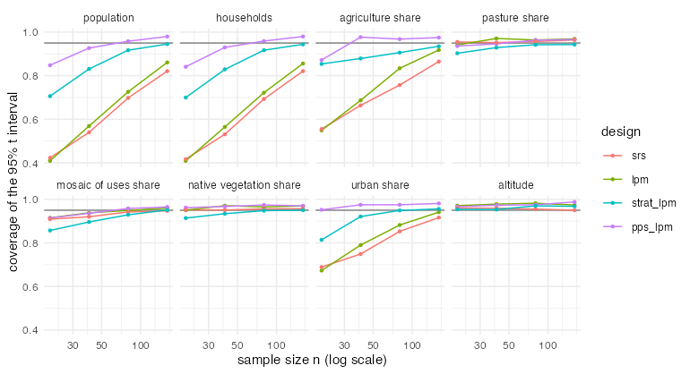

# E1c — skewed variables: stratification and size measures from earlier land use

Generated by `experiments/analysis/e1c_summary.R` from `experiments/out/e1c` (end 2026-10-10 18:02:18 elapsed 12.7 min).

## Question

In E1b, population, households, urban and agriculture shares were so skewed across the 1 km cells
that the 95% intervals covered 0.61 to 0.86 under every equal-probability design. Do stratification
and probability proportional to size, built from land use observed six years earlier (MapBiomas
2018), restore the coverage, and at what routed cost?

## Design

- Frame F4 as in E1b (IBGE 2022 1 km grid, Vale do Ipojuca; targets from the 2022 census and
  MapBiomas 2024). Auxiliary information: the MapBiomas 2018 shares of urban, agriculture and mosaic.
- `strat_lpm`: strata urban (urban 2018 >= 10%), farmed (agriculture + mosaic 2018 >= 10%) and other (farmed 511, other 6850, urban 507 cells); lpm within
  strata; Bethel allocation on the three 2018 shares, shares of n: farmed 0.46, other 0.32, urban 0.22.
- `pps_lpm`: lpm with probabilities proportional to 0.1 + urban + agriculture + mosaic shares of 2018.
- References srs and lpm (equal probabilities). 1000 samples per design and n in {20, 40, 80, 160}; routed cost curves for every design; equal budget as in E1/E1b.

Skewness of the variables across cells (coefficient of variation) and their correlation with the
size measure:

|y                       |   cv| cor_size|
|:-----------------------|----:|--------:|
|population              | 6.25|     0.66|
|households              | 6.35|     0.66|
|agriculture share       | 5.62|     0.41|
|pasture share           | 0.76|    -0.03|
|mosaic of uses share    | 1.18|     0.25|
|native vegetation share | 0.59|    -0.40|
|urban share             | 3.92|     0.83|
|altitude                | 0.25|    -0.14|

## Coverage of the 95% t interval (mean over n)

|y                       |   srs|   lpm| strat_lpm| pps_lpm|
|:-----------------------|-----:|-----:|---------:|-------:|
|population              | 0.620| 0.641|     0.850|   0.928|
|households              | 0.615| 0.638|     0.847|   0.927|
|agriculture share       | 0.710| 0.747|     0.893|   0.948|
|pasture share           | 0.957| 0.961|     0.929|   0.953|
|mosaic of uses share    | 0.929| 0.941|     0.908|   0.943|
|native vegetation share | 0.954| 0.964|     0.936|   0.968|
|urban share             | 0.802| 0.822|     0.910|   0.971|
|altitude                | 0.956| 0.976|     0.961|   0.976|

## Design effect at equal n (true variance relative to srs, mean over n)

|y                       |  lpm| strat_lpm| pps_lpm|
|:-----------------------|----:|---------:|-------:|
|population              | 0.76|      0.18|    0.08|
|households              | 0.75|      0.18|    0.08|
|agriculture share       | 0.66|      0.12|    0.10|
|pasture share           | 0.74|      2.14|    1.36|
|mosaic of uses share    | 0.83|      1.54|    0.75|
|native vegetation share | 0.69|      1.86|    1.63|
|urban share             | 0.79|      0.15|    0.11|
|altitude                | 0.28|      1.01|    2.85|

## Price: travel relative to srs at equal n

|design    |limit  | n <= 40| 40 < n <= 150| n > 150|
|:---------|:------|-------:|-------------:|-------:|
|lpm       |daily  |    1.10|          1.12|    1.12|
|lpm       |single |    1.09|          1.13|    1.14|
|pps_lpm   |daily  |    1.09|          1.08|    1.06|
|pps_lpm   |single |    1.08|          1.10|    1.10|
|strat_lpm |daily  |    1.01|          0.98|    0.95|
|strat_lpm |single |    1.02|          1.00|    0.98|

## Equal budget: variance relative to srs (mean over route limits, interview costs and budgets)

|y                       |  lpm| strat_lpm| pps_lpm|
|:-----------------------|----:|---------:|-------:|
|population              | 0.78|      0.18|    0.09|
|households              | 0.77|      0.18|    0.08|
|agriculture share       | 0.68|      0.12|    0.10|
|pasture share           | 0.76|      2.14|    1.39|
|mosaic of uses share    | 0.85|      1.54|    0.77|
|native vegetation share | 0.70|      1.86|    1.66|
|urban share             | 0.81|      0.15|    0.11|
|altitude                | 0.28|      1.01|    2.92|

Sample size each design affords relative to srs:

|design    | n_ratio|
|:---------|-------:|
|srs       |    1.00|
|lpm       |    0.98|
|strat_lpm |    1.00|
|pps_lpm   |    0.98|

## Bias of the variance estimator (mean over n)

|y                       |srs |lpm  |strat_lpm |pps_lpm |
|:-----------------------|:---|:----|:---------|:-------|
|population              |-0% |+19% |+33%      |+58%    |
|households              |+0% |+19% |+34%      |+59%    |
|agriculture share       |-1% |+26% |+15%      |+59%    |
|pasture share           |+5% |+15% |+12%      |+16%    |
|mosaic of uses share    |+6% |+12% |+13%      |+17%    |
|native vegetation share |+5% |+15% |+14%      |+23%    |
|urban share             |+0% |+23% |+19%      |+51%    |
|altitude                |+8% |+43% |+40%      |+44%    |

## What this means

1. **Auxiliary information six years old fixes the skewed variables.** For population, households,
   urban and agriculture shares, stratification cuts the variance by 82 to 88% against srs and the
   size measure by 89 to 92%, and the t interval covers 0.85 to 0.89 (strata) and 0.93 to 0.97 (size
   measure) instead of 0.61 to 0.82. Their correlation with the 2018 size measure is 0.41 to 0.83.
2. **Concentrating the sample costs no travel.** Stratified samples travel as much as srs or less
   (0.95 to 1.02): the urban and farmed strata are compact, which offsets the spread of lpm within
   strata. The size-measure design pays 6 to 10%, less than unstratified lpm (9 to 14%).
3. **It is a multi-purpose trade-off.** The same designs inflate the variance of the variables that
   are spread evenly or anticorrelated with the 2018 use: pasture 1.4 to 2.1 times srs, native
   vegetation 1.7 to 1.9, altitude up to 2.9 under the size measure. Equal-probability lpm is the only
   design that improves on srs for every variable (variance 0.28 to 0.85 of srs), but it leaves the
   skewed variables with poor intervals. Heikkinen et al. (2025) warn of the same danger of highly
   non-proportional allocation in multi-purpose surveys.
4. **Practical rule for an area frame of this kind**: stratify with a take-more urban/farmed stratum
   and keep lpm within strata, but allocate closer to proportional than Bethel's optimum for the
   skewed variables alone (the package's `multivariate_allocation()` with targets for the evenly
   spread variables too), or use a size measure with a larger floor than 0.1. The cost side is
   favourable either way; the choice is about which variables carry the survey.
5. **Variance estimation**: the local-mean estimator stays conservative under unequal probabilities
   (+15 to +59%), so the intervals of the size-measure design are, if anything, too wide.
